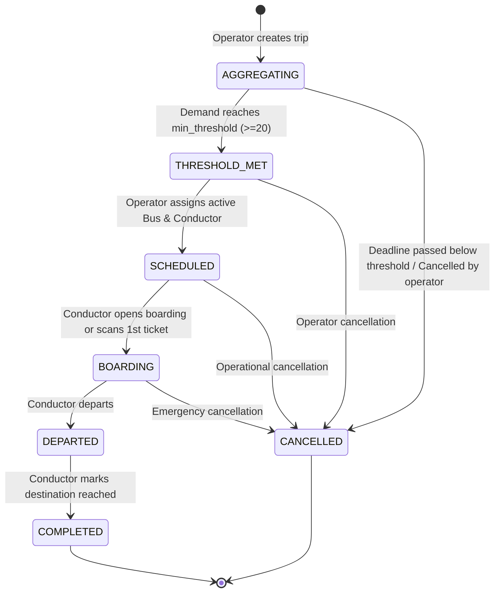

# RailBus API Specification & State Rules

This document specifies the complete REST API interface, role-based access control (RBAC), and centralized state machine rules for the RailBus platform.

---

## 1. Domain Entities & State Machine

### 1.1 Trip State Machine

A `Trip` represents a scheduled journey unique on `(train_arrival_id, route_id, travel_date)`. All status updates are processed through the centralized state transition function [`transition_trip_state()`](file:///Users/bharathparameshwara/Desktop/railbus-backend/app/services/state_machine.py).

#### State Transition Side Effects:
1. **Transition to `SCHEDULED`**:
   - Tickets are issued for all `CONFIRMED` bookings with HMAC-signed QR codes.
   - Passengers receive `TRIP_SCHEDULED` notifications.
   - Audit log recorded.
2. **Transition to `CANCELLED`**:
   - All `CONFIRMED` and `PENDING_PAYMENT` bookings are transitioned to `CANCELLED`.
   - All successful payments are marked as `REFUNDED` with `refunded_at` timestamps.
   - Any issued tickets are transitioned to `CANCELLED`.
   - Passengers receive `PAYMENT_REFUNDED` notifications.
   - Audit log recorded.
3. **Transition to `BOARDING`**:
   - Passengers receive `BOARDING_OPEN` notifications.
   - Audit log recorded.

---

## 2. Role-Based Access Control (RBAC)

| Role | Permissions |
| :--- | :--- |
| **PASSENGER** | Search routes, list trips, create pending bookings, simulate payments, view own bookings, view tickets. |
| **CONDUCTOR** | View assigned trips, inspect passenger manifest, open boarding window, online QR scanning, offline batch synchronization, depart trip, complete trip. |
| **OPERATOR** | Create trips, assign bus & conductor to threshold-met trips, manage trains & train arrivals, view admin overview, assignments, conductors, and audit logs. |
| **ADMIN** | Full superset access across all endpoints. |

---

## 3. Comprehensive Endpoint Catalog

### Authentication (`/api/v1/auth`)
| Method | Endpoint | Allowed Roles | Description | Response Model |
| :--- | :--- | :--- | :--- | :--- |
| `POST` | `/api/v1/auth/register` | Public | Register new user account with role | `UserResponse` |
| `POST` | `/api/v1/auth/login` | Public | Authenticate user, rate limited per role | `TokenResponse` |
| `GET` | `/api/v1/auth/me` | Authenticated | Retrieve authenticated user profile | `UserResponse` |

### Routes & Buses (`/api/v1`)
| Method | Endpoint | Allowed Roles | Description | Response Model |
| :--- | :--- | :--- | :--- | :--- |
| `GET` | `/api/v1/routes` | Public | List routes with search and `route_type` filter (`CITY`, `INTERCITY`) | `List[RouteResponse]` |
| `GET` | `/api/v1/routes/{route_id}` | Public | Detailed route information with ordered stops | `RouteResponse` |
| `GET` | `/api/v1/buses` | Public | List fleet buses with status and capacity | `List[BusResponse]` |

### Trips (`/api/v1/trips`)
| Method | Endpoint | Allowed Roles | Description | Response Model |
| :--- | :--- | :--- | :--- | :--- |
| `GET` | `/api/v1/trips` | Public | List trips filtered by status or route | `List[TripResponse]` |
| `GET` | `/api/v1/trips/search` | Public | Search trips by destination, connecting train number, and date | `List[TripResponse]` |
| `GET` | `/api/v1/trips/{trip_id}` | Public | Get single trip overview and seat availability | `TripResponse` |
| `POST` | `/api/v1/trips` | `OPERATOR`, `ADMIN` | Create a new trip in `AGGREGATING` status | `TripResponse` |
| `POST` | `/api/v1/trips/{trip_id}/assign` | `OPERATOR`, `ADMIN` | Assign active bus and conductor to trip with `THRESHOLD_MET` | `TripResponse` |

### Bookings (`/api/v1/bookings`)
| Method | Endpoint | Allowed Roles | Description | Response Model |
| :--- | :--- | :--- | :--- | :--- |
| `POST` | `/api/v1/bookings` | `PASSENGER`, `ADMIN` | Create pending booking; checks available capacity | `BookingResponse` |
| `GET` | `/api/v1/bookings/my` | `PASSENGER` | List authenticated passenger's bookings | `List[BookingResponse]` |
| `GET` | `/api/v1/bookings/{booking_id}` | Owner / `ADMIN` | Retrieve single booking details | `BookingResponse` |
| `GET` | `/api/v1/bookings/{booking_id}/ticket` | Owner / `ADMIN` | Retrieve issued digital ticket with QR code data | `TicketResponse` |
| `POST` | `/api/v1/bookings/simulate-payment` | `PASSENGER`, `ADMIN` | Atomic capacity check & payment confirmation; triggers threshold check | `PaymentResponse` |

### Tickets (`/api/v1/tickets`)
| Method | Endpoint | Allowed Roles | Description | Response Model |
| :--- | :--- | :--- | :--- | :--- |
| `GET` | `/api/v1/tickets/{ticket_id}` | Authenticated | Retrieve ticket details with rendered QR PNG data URL | `TicketResponse` |
| `POST` | `/api/v1/tickets/validate` | Authenticated | Verify HMAC signature of scanned QR string | `TicketValidationResponse` |

### Conductor Operations (`/api/v1/conductor`)
| Method | Endpoint | Allowed Roles | Description | Response Model |
| :--- | :--- | :--- | :--- | :--- |
| `GET` | `/api/v1/conductor/trips` | `CONDUCTOR`, `ADMIN` | List trips assigned to currently authenticated conductor | `List[ConductorTripSummary]` |
| `GET` | `/api/v1/conductor/trips/{trip_id}/manifest` | Assigned Conductor | Retrieve passenger manifest with boarding statuses | `ManifestResponse` |
| `POST` | `/api/v1/conductor/trips/{trip_id}/boarding/open` | Assigned Conductor | Opens passenger boarding window via state machine | `TripResponse` |
| `POST` | `/api/v1/conductor/trips/{trip_id}/board` | Assigned Conductor | Board passenger ticket with scan device and client scan ID | `BoardTicketResponse` |
| `POST` | `/api/v1/conductor/trips/{trip_id}/sync-offline` | Assigned Conductor | Batch sync offline scans with duplicate and foreign ticket checks | `OfflineSyncBatchResponse` |
| `POST` | `/api/v1/conductor/trips/{trip_id}/depart` | Assigned Conductor | Transition trip to `DEPARTED` via state machine | `TripResponse` |
| `POST` | `/api/v1/conductor/trips/{trip_id}/complete` | Assigned Conductor | Transition trip to `COMPLETED` at destination | `TripResponse` |

### Admin Dashboard & Operations (`/api/v1/admin`)
| Method | Endpoint | Allowed Roles | Description | Response Model |
| :--- | :--- | :--- | :--- | :--- |
| `GET` | `/api/v1/admin/overview` | `OPERATOR`, `ADMIN` | System overview stats: active buses, trips breakdown, bookings | `AdminOverviewResponse` |
| `GET` | `/api/v1/admin/conductors` | `OPERATOR`, `ADMIN` | List all conductors with employee IDs and availability | `List[ConductorAdminResponse]` |
| `GET` | `/api/v1/admin/assignments` | `OPERATOR`, `ADMIN` | List pending and scheduled bus/conductor assignments | `List[AdminAssignmentItem]` |
| `GET` | `/api/v1/admin/audit-logs` | `OPERATOR`, `ADMIN` | System audit logs of all state transitions and assignments | `List[AuditLogResponse]` |
| `GET` | `/api/v1/admin/trains` | `OPERATOR`, `ADMIN` | List all trains | `List[TrainResponse]` |
| `POST` | `/api/v1/admin/trains` | `OPERATOR`, `ADMIN` | Create a new train entity | `TrainResponse` |
| `GET` | `/api/v1/admin/train-arrivals` | `OPERATOR`, `ADMIN` | List scheduled train arrivals | `List[TrainArrivalResponse]` |
| `POST` | `/api/v1/admin/train-arrivals` | `OPERATOR`, `ADMIN` | Create scheduled train arrival connecting to route | `TrainArrivalResponse` |

### Notifications (`/api/v1/notifications`)
| Method | Endpoint | Allowed Roles | Description | Response Model |
| :--- | :--- | :--- | :--- | :--- |
| `GET` | `/api/v1/notifications` | Authenticated | List notifications for authenticated user | `List[NotificationResponse]` |
| `PATCH` | `/api/v1/notifications/{id}/read` | Owner | Mark notification as read | `NotificationResponse` |
